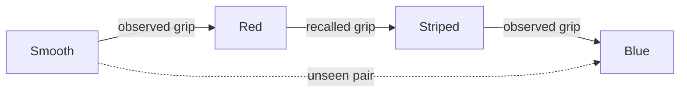

# Learning a relationship through action

A freshly hatched Axion creature can learn how two visible properties interact, use its experience to open objects it has never encountered, and adapt when the chemistry changes. On the most controlled test, the same genotype received identical objects and motor options in two lifetimes. Only the consequences of its actions differed. It chose correctly on **129,872 out of 129,872** probes where the two worlds required different actions. The first action in each lifetime was chosen without any examples. [Complete independent audit](relations/audit.csv)

## Teach one creature

```sh
make -j NATIVE=1 CUDA_ARCH=sm_120
./axion agent --from examples/relations.eco --lesson examples/relations.lesson --save pupil.mind
./axion agent --load pupil.mind --inspect
./axion life --load examples/thicket.eco --steps 4096 --report-every 512 --map
```

The sensory lesson teaches one animal in two successive environments. There are eight shapes, eight textures and four grips. Half the pairs are available for practice. Each round provides 256 encounters with a one-bit consequence after the creature acts. A frozen probe can inspect a pending bodily signal on a copy. It cannot change the animal or present the correct grip as an input. The second environment reuses the same sensors, same creature and same withheld pairs. Its new response table can assign identical effects to different categories. [External lesson](../examples/relations.lesson)

| Correct on the 32 unseen pairs | Before practice | After practice |
| --- | ---: | ---: |
| First chemistry, privately relabeled cyclic responses | 7 | 32 |
| Second chemistry, private many-to-one responses | 9 | 17 |

The animal matched 402 of 512 training encounters. Its saved state occupies **552 bytes**, including its genome, 256-cell tissue capacity, all acquired contacts, pending signals, clock, file header and checksum. There are **528 bytes of device-resident state**. CUDA code, context and event batching have separate costs. The lesson uses an independent generator and passes raw receptor masks through the public agent command. [Saved individual](../examples/relations.mind) · [Generator](../tools/relational-study.py)

## The circuit

The starting unary circuit could learn which property mattered. On a task that required the joint effect of both properties, it scored 32,762/131,072 unseen pairs. That failure motivated adding connections between sensory populations, along with a way for one recollection to activate another. The inherited cellular update program still selects motor actions through the spiking soma. [Unary experiment and checkpoint](learning.md)

For a concrete example, imagine the creature has opened a striped blue fruit, a striped red fruit and a smooth red fruit. When it first sees a smooth blue fruit, those experiences provide an indirect path between its two sensory populations. The internal motor spikes on that path can affect its next grip. Whether agreement, disagreement or a particular sequence helps depends on the creature's genes and what happened during this lifetime.



- Two fields of 16 receptor channels can form 256 coincidences. Each one has four binary contacts onto internal motor fibres. A mutation can rotate the receptor field or reconnect the fibres to different proprioceptive output bits. A neuron's two-bit tag is produced from its own motor discharge.
- A contact's entire Boolean update table is inherited. Its inputs are its previous bit, sensory coincidence, a motor discharge and a metabolic signal. All 16 input rows can change independently. Founders start with an identity table. The stored state can be changed only through experience under the expressed table.
- A query excites paths across three individually unambiguous contacts. One intermediate spike per row bounds the work. Its three motor tags can activate one of 64 internal assemblies. Another 256 mutable contacts connect these assemblies back to the four fibres. Their update table is inherited independently.
- Recurrent paths can also transport phase through four wires of mutable switches. The middle connection conducts in reverse. The phase at the end can excite the motor fibres with a matching response. A circuit can inhibit or facilitate paths according to which of their fibres fired together.
- Additional cells integrate repeated agreements and disagreements across contexts. Two genetically specified truth tables control their firing from four inputs. Each input reports whether agreement or disagreement occurred at least once or twice. The motor circuit has mutable gain and competition. The reduction over the two thresholds uses a register word for 16 candidate columns.

The substrate supplies coincidence detection, timing, routing, memory capacity and a finite motor interface. Evolution supplies the expressed learning tables, switch wiring, gains, thresholds encoded in the tables, and much of the spiking circuit. The scoring code alone knows the hidden chemistry. The predictor receives raw spikes, its own action and subsequent bodily feedback. A proof of biological sufficiency, unrestricted representations and human-level development remain open. [Neural circuit](../src/associations.cuh) · [Independent environment and interventions](../src/conditioning.cuh)

## What the population learned

Each of 16 independent breeding runs started with 256 candidate genotypes, identity updates at the new synapses and silent convergence tables. For 320 generations, a GPU nursery evaluated action consequences on one-property problems and a mixture of joint problems. The programs were bred on eight or sixteen values per property. The response assignments changed across generations. Selection had access to four performance totals. The animal had access to its senses and feedback. Each run evaluated 1,310,720 fresh lifetimes. Six matched drift runs sampled parents without scoring them. [All populations, including failures](relations/breeding.csv)

The released nursery population was selected by its worst accuracy across three validation tasks, with the sum breaking ties. The winner used 16 property values and founding seed 2203. Freshly breeding all candidates a second time reproduced the released habitat byte for byte. Four different seeds supplied the following audit. Every probe used a copy of acquired state, with no feedback. The unstructured task independently hashed the response for every pair. The latent-table family was withheld from both nursery selection and validation. [Released population](../examples/relations.eco) · [Raw integer counts](relations/audit.csv)

| Task, 32 encounters per property value | Correct on first test of unseen pairs | Same acquired brain with indirect paths cut | Correct on changed answers after retraining |
| --- | ---: | ---: | ---: |
| Relevant property switches from shape to texture or back | 100.00% | 34.53% | 98.59% |
| Cyclic composition | 100.00% | 24.86% | 99.44% |
| Parity composition | 100.00% | 24.86% | 99.47% |
| Privately relabeled cyclic or parity law | 100.00% | 24.95% | 99.52% |
| Law and output convention switch during life | 100.00% | 24.95% | 94.55% |
| Each shape uses its own permutation of texture kinds | 93.45% | 24.97% | 91.32% |
| Each texture uses its own permutation of shape kinds | 92.00% | 25.05% | 88.47% |
| Unseen random response table over recurring latent kinds | 88.62% | 27.39% | 81.40% |
| Independently assigned response for each visible pair | 24.84% | 25.03% | 24.95% |

There are 16 values on each axis, 128 practiced pairs, and 128 held-out pairs. Thirty-two encounters per value means **512 training choices** per phase. For the privately relabeled mixture, 4,096 lifetimes produced 524,288 held-out probes. They all succeeded. Cutting only indirect activity during the frozen query left 130,797 correct. Yoking the metabolic signals to another animal while preserving their total gave 24.90%. The discordant subset in the opening paragraph excludes every cue for which one choice would work in both mirrored worlds. The independent experimental units are rule sets and founding populations. The probes within a lifetime share acquired state. [Interventions and denominators](relations/audit.csv)

Different components contributed on different tasks. Silencing the inherited phase switches left this population at 100% on the mixed-law test. Freezing the learned internal sequence contacts left it at 98.38% there and reduced its score on shape-specific permutations from 93.45% to 78.14%. Removing the genetically selected motor competition reduced those scores to 35.67% and 26.48%. The isolated mechanisms and their overlap matter when interpreting a successful whole brain. [Component interventions](relations/audit.csv)

Data efficiency is a substantial limitation. With two encounters per property value, the population scored 25.0% on the mixed-law task and 29.1% on the latent table. At eight encounters it scored 34.2% and 38.4%. Its one-property arbitrary-grip score at 32 encounters was 58.4%. The earlier unary population reached 98.5% on its arbitrary-grip audit. A high score on compound objects can coexist with a loss on a different skill. [Acquisition curves](relations/audit.csv) · [Unary learner](learning.md)

## Propagation through sparse experience

Suppose an animal encounters only **32 of the 256 possible pairs**. Each property occurs with two others. The experiences form a cycle through 32 sensory vertices. Some unseen pairs lie fifteen connections apart. A three-contact circuit cannot carry a signal that far.

`--relations waves` permits a cellular automaton to run on the graph the animal has learned. An excited phase cell can send spikes through an unambiguous contact. The contact's motor fibre transforms their phases through inherited switches. Each vertex has a transient refractory bit, and excitation stops at the query, on exhaustion, or at an inherited limit of 7, 15 or 31 steps. Another allele can silence the wave. The four phase populations on 16 vertices fit into two register words. The extra range costs **zero additional persistent bytes per animal**. The transient computation and register costs are real.

The varied nursery selects the same genotype on arbitrary grips, dense interactions and sparse chains. Six populations started with fresh genes and six inherited from living thicket descendants. Each ran 320 generations on **eight values** per property. The selected population inherited from the thicket and used founding seed 3179. The worst of its four validation scores determined selection. All twelve populations and the independent audit are included. [Breeding results](relations/pathways.csv) · [Held-out counts](relations/distance.csv)

| Encounters per value in a 16-value cycle | Correct on 224 unseen pairs per lifetime | Correct at distances 9–15 | Same state, long propagation cut at query |
| ---: | ---: | ---: | ---: |
| 2 | 25.13% | 24.98% | 24.98% |
| 4 | 26.73% | 25.05% | 25.01% |
| 8 | 97.65% | 97.35% | 24.94% |
| 16 | **98.55%** | **98.45%** | **24.94%** |
| 32 | 98.55% | 98.45% | 24.92% |

At 16 encounters per value, 2,048 fresh lifetimes yielded **258,089/262,144** correct probes at distances beyond the maximum possible in the eight-value practice cycle. Disabling long propagation only during readout left **65,373/262,144** correct on the same trials. Yoked feedback yielded 24.90% overall. Splitting the experience graph into two disconnected cycles and querying only across them yielded 24.99% and zero connected probes. Changing the sparse physical law to parity yielded only 50.87% on the long paths. The animal learns its contacts from experience. Its inherited phase wiring gives it a preference for particular interaction laws. [Sparse, disconnected and changed-law controls](relations/distance.csv)

This same population reached **99.73%** on arbitrary one-property grips, **98.82%** on dense privately relabeled laws, and **85.06%** on the withheld latent tables. For a separate test, an external script shuffled the physical receptor channels and practice order and presented only raw spikes. The first occupied donor's descendant scored **57/224** before practice and **224/224** after 256 attempts. Saving, restoring and probing all 224 pairs again preserved the 552-byte file byte for byte. [Population](../examples/pathways.eco) · [Experienced individual](../examples/pathways.mind)

```sh
tools/relational-study.py chain-lesson | ./axion agent --from examples/pathways.eco --save pathfinder.mind
./axion life --load examples/pathways.eco --steps 0 --problem chains --varieties 16 --exposures 16 --conditioning 64
./axion agent --load pathfinder.mind --inspect
```

The reciprocal ecological competition starts two groups with matched genomes, one with full propagation and one limited to local paths. At tick 2,048, the groups had 4,869 and 8,094 survivors respectively across 16 inherited-fruit worlds. The observed long-range inference advantage did not translate into higher pooled survival in those worlds. [Reciprocal wave controls](relations/wave-garden.csv)

## A world that changes with its inhabitants

A thicket adds one 16-byte plant genome at each site. Two words map visible features to latent chemical qualities. A third contains a freely mutable four-by-four reaction table that determines how a fruit responds to the animal's four grips. A fourth controls traits including seeding, seed mass and mutation. Neighboring plants compete for space. Grazing changes their biomass and which plants can place a seed. A successful seed transfers biomass from its parent and displaces the local strain. Plants and animals can both evolve while the simulation is running.

The world updates disjoint two-by-two neighborhoods, changing the partition each tick. All individuals read a common world snapshot. A single kernel resolves the local exchange of energy, movement, reproduction and plant dispersal. A seed operation touches only cells owned by that thread and needs no global atomic. The creature's neural tissue is a different cellular automaton. Its cells operate on inherited recurrent connections and can mutate the instructions governing synaptic change. These two uses of cellular automata give local interactions persistent consequences at an affordable GPU cost. They leave the long-term production of behavioral novelty as an empirical question.

The three fruit treatments expose an ecological assumption. With scattered fruit, every grasp reveals a new object. Persistent fruit remains available after a failed grip. Inherited fruit also lets individual plants specify which visible features recur among their offspring's fruit. It can still change when another seed takes the site. The physical recognition test always runs after the animal acts. [CUDA habitat](../src/life.cu)

Four untrained thickets followed for 32,768 ticks recorded 47,610,147 plant seedings with grazing animals present. In matched plots started without animals, 23,021 seedings occurred before stored biomass filled the plots and propagation stopped. Clonal plants still spread. Fixed plants retained their original positions and genotypes. Each census checks conservation across animal energy, plant biomass, stores, pending digestion and metabolic expenditure. The neighboring-response statistic probes one predetermined appearance on each right and downward spatial edge. [All planted, clonal, fixed and grazer-free controls](relations/field.csv)

## Can these animals make a living?

The nursery winner died out in all 16 reciprocal releases with scattered fruit and mutation frozen. With inherited fruit, 9,313 animals survived across the same 16 releases at tick 2,048. Of those, 1,711 had intact indirect pathways and 7,602 had those pathways silenced. The placement of the two groups was reversed for each founding seed. Success in the isolated learning test gave the intact group no general ecological advantage in this experiment. [Reciprocal releases in all three fruit treatments](relations/contests.csv)

To find an individual with both abilities, I screened the first 16 occupied sites in each of three nursery populations with different survival and learning histories. Each genotype founded its own 32 × 32 thicket. Mutation was disabled for this screen so survival and learning could be attributed to descendants of that exact genotype. All 48 isolates reproduced and survived for 2,048 ticks with inherited fruit. The winning isolate, site 14 from the 16-value seed-1277 nursery, produced 17,360 births, finished with 256 animals, and scored 32,768/32,768 on the two private laws and 15,584/16,384 on texture-specific grip permutations. [All isolates and the selection criterion](relations/isolates.csv)

The supplied living thicket starts from this isolate in a separate world with mutation enabled in both populations from its first tick. At the saved tick 512, it contains **330 living animals** after 3,084 births and 3,113 deaths. The deepest surviving lineage spans 32 divisions. Plants have seeded 23,272 times and their descendants have accumulated 5,204 mutations. The checkpoint includes the animals' acquired neural state and the local plants. [Living thicket](../examples/thicket.eco)

To test retention under ecological selection, I transplanted germline genomes from the living thicket into four fresh worlds and re-tested newborn descendants after 4,096 and 32,768 ticks. Accuracy on fresh mixed laws averaged 64.25% at founding. With mutation enabled it declined to 37.91% and then **19.68%**. With mutation frozen it averaged 63.15% and then **70.85%**. A body can evolve away from the four physical grips needed to pass the test. The mutation switch applies to animals and plants. The long runs demonstrate survival and evolutionary change. They also document the loss of a previously measured ability. [Independent ecological generations](relations/retention.csv)

## A million ticks from one genome

Three independent 32 × 32 thickets started with copies of the **same individual** that completed the external 224-pair lesson. Each animal started a new life with untrained contacts. Each world ran for **1,048,576 ticks** with a matched mutation-frozen twin. There was no nursery or performance-based parent selection during these runs. Local energy, birth, death and dispersal determined what persisted. [Six trajectories](relations/deep-time.csv)

At six ages, a CUDA survey sampled up to 128 living donors. Each germline was expressed twice from birth under the same 64 encounters, with two different contingent physical outcomes. Sixteen frozen probes per history recorded the entire effector byte. The resulting 32-byte repertoire records choices under a fixed battery of sensory situations. It is compared exactly, with no genome labels or hash collisions. Every sample uses the same stimuli and tie breaks. Counts therefore measure observed behavioral differences in this assay, with a finite sampling ceiling. [Exact response vectors, multiplicities and exemplar sites](relations/repertoires.csv)

| World | Living at final tick | Deepest surviving lineage | Distinct repertoires sampled across six ages | First seen at final sample | Energy deposited / retrieved | Sparse learning at final sample |
| ---: | ---: | ---: | ---: | ---: | ---: | ---: |
| 1801 | 311 | 18,628 | 191 | 37 | 1,511,384 / 86,746 | 23.02% |
| 3929 | 469 | 5,669 | 224 | 27 | 90,778 / 3,115 | 15.84% |
| 8059 | 349 | 7,901 | 232 | 26 | 125,847 / 14,092 | 19.97% |

The founder's eight physical outputs were `4d,1a,2f,49,18,3c,cf,0a` in hexadecimal. Accessing a public store requires both bits in `0x90`. The founder could perform neither store operation. Descendants in **all three mutating worlds** came to deposit and retrieve energy. Their three frozen twins performed zero of either transaction over the entire run. All three frozen twins kept one standardized repertoire and scored 100% on the same sparse audit. Reproduction and bodily energy were sufficient for the appearance of a new use of the environment, even as the original inference ability declined. Whether caching involved planning is an independent question. The world already supplied the storage interface.

The released million-tick checkpoint is the first mutating replicate. An independent uninterrupted run reproduced every byte of the checkpoint generated with the six surveys and intervening saves and restores. At site 3, a surviving animal carries an effector with byte `94` that can withdraw stored energy. The snapshot can be resumed or used to hatch that specific genotype. These finite experiments establish ongoing change at the sampled times. Sustained open-ended innovation and child-level cognition remain unestablished. [Million-tick world](../examples/descendants.eco)

```sh
./axion life --load examples/descendants.eco --steps 0 --survey 128 --survey-seed 473327
./axion agent --from examples/descendants.eco --site 3 --inspect
./axion life --load examples/descendants.eco --steps 65536 --save later.eco
```

## CUDA costs

The associative phenotype adds **176 bytes per allocated animal slot**. Sixteen are inherited and 160 encode 1,280 mutable binary contacts. Each sensory coincidence can connect to any subset of four motor fibres. Four bits are the minimum fixed-width representation of those 16 states. The field circuit uses two 16-bit masks per 32-bit register and cooperative warp shuffles. An inactive contact is written back only when the expressed truth table can change it. The thicket adds 16 bytes per plant and 16 bytes of propagation counters per four-site patch. Small worlds use dense dispatch. The occupied scheduler packs living animals directly from a warp ballot and allocates no queue.

The GPU loads code according to the command. On the native test build, a standalone individual loaded an **865,704-byte** neural image. The world used a 2,286,432-byte habitat image, with the 12,140,776-byte experimental image loaded for breeding, surveys or assays. These values are native executable sizes. The CUDA driver manages additional context memory.

The following native SM 12.0 measurements use the RTX PRO 2000 Blackwell Generation Laptop GPU. Each row restores one warm habitat and times the next 96 ticks with CUDA events, including individual learning, plants, movement, reproduction and energy accounting in the simulation kernels. The times are medians of three repetitions. Both schedules produced identical final fingerprints at each size. A somatic update counts one expressed cell transition for one microtick. Extra associative work is included in the time. [Per-run counts and register usage](relations/gpu.csv)

| Sites per side | Living at start → finish | Explicit device memory | Dense time | Occupied time |
| ---: | ---: | ---: | ---: | ---: |
| 64 | 378 → 1,269 | 2.35 MB | 2.754 ms | 3.895 ms |
| 256 | 7,307 → 19,901 | 37.56 MB | 21.766 ms | 16.514 ms |
| 512 | 30,679 → 79,834 | 150.24 MB | 105.729 ms | 75.673 ms |
| 1,024 | 122,754 → **317,677** | **600.97 MB** | 429.352 ms | **303.587 ms** |

The largest run executed 12,295,983,104 somatic updates in that interval. It reserved space for 1,048,576 animal slots and 1,048,576 plants. The measured brain and habitat kernels both used zero bytes of thread-local memory. The allocator count excludes CUDA context, executable modules, graph internals and host checkpoint staging.

I repeated the scaling experiment with the long-range circuit enabled and its selected population. At the same million-site capacity it grew from 83,010 to **282,537 live animals**. The occupied scheduler completed 19,666,771,712 somatic updates in a median **300.257 ms**, or **65.50 billion per second**, using the same 600,965,380 bytes of explicit buffers. The two populations express different tissue sizes and produce different trajectories. Their somatic rates measure different workloads. [Wave-enabled GPU measurements](relations/wave-gpu.csv)

For an energy measurement, the study matched the CUDA device's PCI address to NVIDIA's cumulative board-energy counter. Three runs per scheduler advanced the same 512 × 512 world by 4,096 ticks. Every run performed **131,332,321,792 somatic updates** and finished with the same fingerprint. Median whole-command board energy was **344.36 J** for dense scheduling and **258.99 J** for occupied scheduling, equivalent to 381 and 507 million active cell updates per joule. The readings include startup, simulation, reporting and other board activity during the interval. Idle samples ranged from 10.87 to 57.05 W. The study reports gross energy and makes no idle subtraction. These measurements apply to this laptop and workload. [Raw board readings](relations/energy.csv) · [NVIDIA energy-counter specification](https://docs.nvidia.com/deploy/nvml-api/latest/api/group__nvmlDeviceQueries.html)

## Research informing the design

Human single-neuron recordings in a context-dependent task found distinct but coordinated populations for stimulus content and context. A human learning study also reported changes in compositional and conjunctive representations with practice. I used these observations to motivate keeping access to individual features and learned coincidences in the same animal. The bit layout and the inherited Boolean programs are engineering choices. [Bausch et al., Nature, 2026](https://www.nature.com/articles/s41586-025-09910-2) · [Compositional and conjunctive representations, 2025](https://pubmed.ncbi.nlm.nih.gov/41253771/)

A study published on 16 November 2026 tested human inference across contexts and perturbed hippocampal activity. The study found a reduction in structure-based inference. It motivated testing established memories under an intervention applied only at the moment of inference. Mathematical work on consistency around cycles in graphs also informs the interpretation of transport through learned edges. [Causal role of human hippocampus in relational structure learning and inference](https://www.nature.com/articles/s41562-026-02627-w) · [Cycle consistency in group synchronization](https://link.springer.com/article/10.1007/s10208-021-09532-w)

A 2026 study of neural cellular automata measured phenotype and genotype diversity under local self-replication. Axion tracks local mutation and inherited physical responses separately, and includes a fixed-plant and a grazer-free counterfactual. More mutations, more births or more distinct genotypes alone cannot establish behavioral innovation. [Self-replicating neural cellular automata](https://www.mdpi.com/2313-433X/12/10/496)

## Reproduce

```sh
make -j NATIVE=1 CUDA_ARCH=sm_120
tools/relational-study.py breed --population regrown.eco > breeding.csv
tools/relational-study.py audit --population regrown.eco > audit.csv
tools/relational-study.py lesson > external.lesson
./axion agent --from regrown.eco --lesson external.lesson --save individual.mind
tools/relational-study.py field > field.csv
tools/relational-study.py isolate --population thicket.eco > isolates.csv
tools/relational-study.py retention --population thicket.eco > retention.csv
tools/relational-study.py contest --population regrown.eco > contests.csv
tools/relational-study.py pathways --population pathways.eco > pathways.csv
tools/relational-study.py distance --population pathways.eco > distance.csv
tools/relational-study.py wave-garden --population pathways.eco > wave-garden.csv
tools/relational-study.py deep-time --population pathways.eco --save-world descendants.eco --repertoires repertoires.csv > deep-time.csv
tools/relational-study.py speed --population thicket.eco > gpu.csv
tools/relational-study.py speed --population pathways.eco > wave-gpu.csv
tools/relational-study.py energy --population thicket.eco > energy.csv
make -j NATIVE=1 CUDA_ARCH=sm_120 test-gpu
```

The Python script launches the C++ executable, generates the external sensory stream and records counts. All neural decisions, within-lifetime changes, breeding, ecological interactions and interventions run on CUDA. The restored world includes its complete plant population and each animal's own acquired state. A new population founded from an existing world inherits germline data. [Study driver](../tools/relational-study.py)

Native SM 12.0 and SM 8.0 PTX execution passed the GPU suite on the Blackwell laptop. It checks all five tissue widths with both relational circuits, direct and graph dispatch, dense and occupied scheduling, delayed feedback, conservation, deterministic resume, frozen external queries, long-path lesions, disconnected controls and identical-germline behavioral surveys. The host-side AddressSanitizer and UndefinedBehaviorSanitizer build passed the GPU suite using the previously measured driver-only leak suppression. The released relational nursery, living thicket and pathway nursery were regenerated byte for byte. [Regression tests](../tests/tests.cpp) · [Driver baseline](ecology.md#verification-on-the-laptop)
